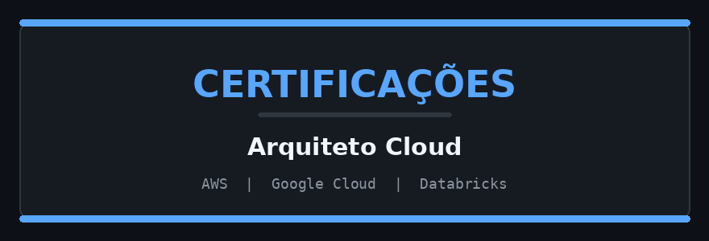

<div align="center">


</div>

<div align="center">

[](https://git.io/typing-svg)

</div>

---

## 👨🏻‍💻 Sobre mim

```python
class MarcusAndrade:
    def __init__(self):
        self.name       = "Marcus Andrade"
        self.role       = "Data Engineer | Cloud Architect"
        self.company    = "HVAR"
        self.location   = "Brasil 🇧🇷"
        self.languages  = {"PT": "Nativo", "EN": "Avançado", "ES": "Básico"}

    @property
    def education(self):
        return [
            "🎓 Tecnologia em Redes - Anhanguera",
            "🎓 MBA Gestão de Projetos - Anhembi Morumbi",
            "🎓 Pós-Grad. Engenharia de Dados - Anhembi Morumbi",
        ]

    @property
    def certifications(self):
        return [
            "Databricks Certified Data Engineer Professional",
            "AWS Certified Solutions Architect Professional",
            "Google Cloud Professional Cloud Architect",
        ]

    @property
    def currently_working_on(self):
        return [
            "Data Foundation AWS (Terraform + Lake Formation)",
            "Data Foundation GCP (BigQuery + Dataproc)",
            "Data Foundation Snowflake (Medallion + RBAC)",
        ]

    def say_hi(self):
        print("Dados bem estruturados resolvem problemas reais. Vamos construir isso juntos! 🚀")
```

---

## 🚀 Tech Stack

### ☁️ Cloud & IaC
<p>
  
  
  
  
  
</p>

### 🐍 Linguagens & Dados
<p>
  
  
  
  
  
  
</p>

### 📊 BI & Visualização
<p>
  
  
  
</p>

### 🛠️ DevOps & Ferramentas
<p>
  
  
  
  
  
</p>

---

## 🏅 Certificações

<div align="center">



</div>

<div align="center">


</div>

---

## 📊 GitHub Stats

<div align="center">


</div>

<div align="center">

[](https://git.io/streak-stats)

</div>

---

## 🌐 Onde me encontrar

<div align="center">

[](https://www.linkedin.com/in/madrade/)
[](https://www.youtube.com/channel/UCgXO6Z43ClpxDmDok4MHwgQ)
[](https://github.com/madrade1472)

</div>

---

<div align="center">


<sub>⚡ <i>"Dados bem estruturados resolvem problemas reais."</i></sub>

</div>
