<div align="center">


<a href="https://git.io/typing-svg"></a>

<p>
  <a href="https://www.linkedin.com/in/madrade/"></a>
  <a href="mailto:marcus.andrade@tecitbettersolution.com.br"></a>
  <a href="https://www.youtube.com/channel/UCgXO6Z43ClpxDmDok4MHwgQ"></a>
  
</p>

</div>

<br/>

<picture>
  <source media="(prefers-color-scheme: dark)" srcset="assets/cards/commits-dark.svg">
  
</picture>

<p>
<picture>
  <source media="(prefers-color-scheme: dark)" srcset="assets/cards/linguagens-dark.svg">
  
</picture>
<picture>
  <source media="(prefers-color-scheme: dark)" srcset="assets/cards/atividade-dark.svg">
  
</picture>
</p>

## 👨🏻‍💻 Sobre mim

```python
class MarcusAndrade:
    role      = "Data Engineer · Cloud Architect"
    location  = "São Paulo, Brasil 🇧🇷"
    languages = {"PT": "nativo", "EN": "avançado", "ES": "básico"}

    certifications = [
        "Databricks Certified Data Engineer Professional",
        "AWS Certified Solutions Architect Professional",
        "Google Cloud Professional Cloud Architect",
    ]

    education = [
        "Pós-graduação em Engenharia de Dados (Anhembi Morumbi)",
        "MBA em Gestão de Projetos (Anhembi Morumbi)",
        "Tecnologia em Redes (Anhanguera)",
    ]

    focus = [
        "Data Foundations em AWS, GCP e Snowflake com Terraform",
        "Lakehouse com Databricks e arquitetura medalhão",
        "Agentes de IA aplicados a dados",
    ]
```

## 🚀 Stack

<p align="center">
  
</p>

<p align="center">
  
  
  
  
  
  
  
  
  
</p>

## 🏅 Certificações

<div align="center">


</div>

## 🐍 Contribuições

<picture>
  <source media="(prefers-color-scheme: dark)" srcset="assets/cards/snake-dark.svg">
  
</picture>

<div align="center">


<sub>Cards gerados todo dia por GitHub Actions a partir da API do GitHub</sub>

</div>
